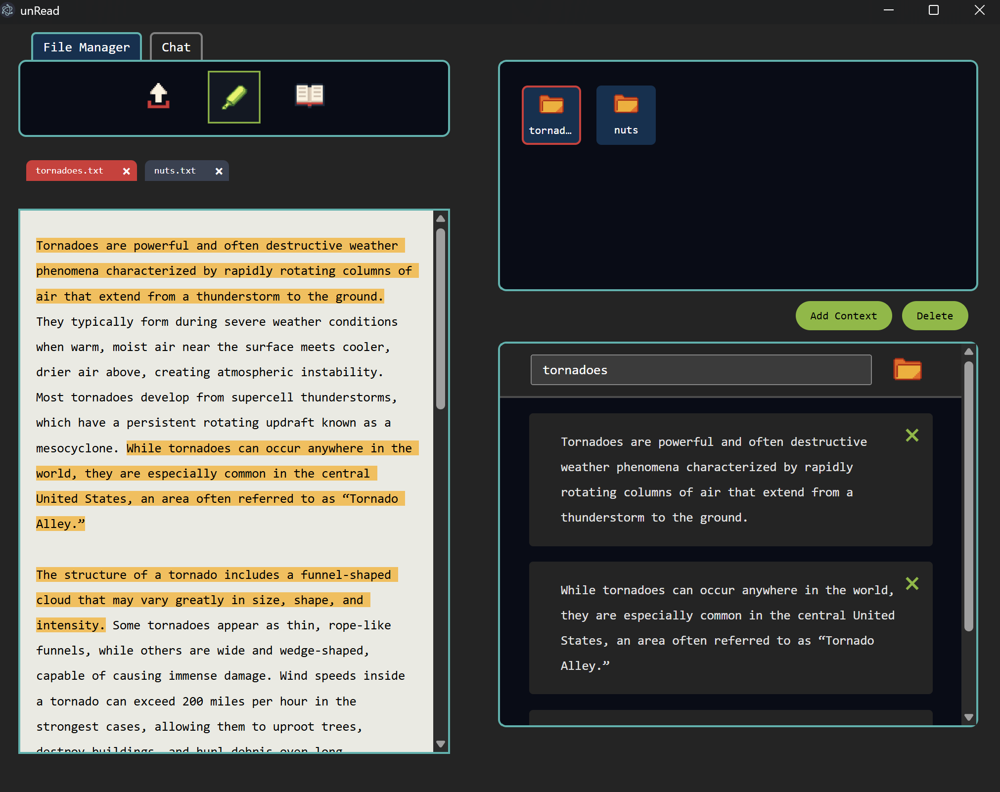
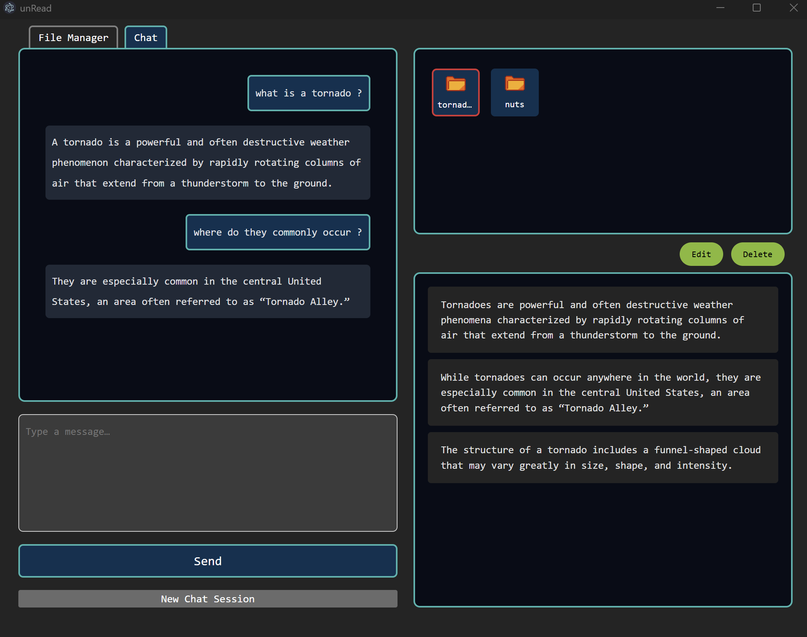
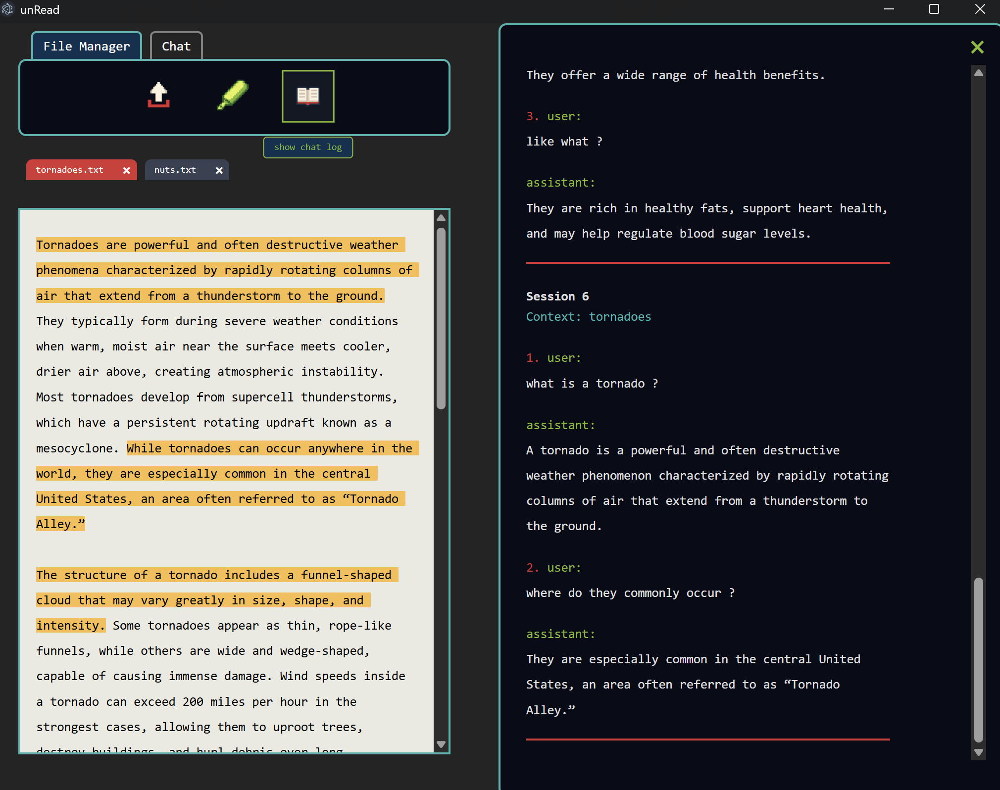

# Context Manager
A hybrid **Electron + React** desktop application where users **select and organize their own context** for AI-assisted chat.
It allows users to highlight text from files, organize it into context folders, and chat with an AI model that answers based solely on the selected context.

---

## Features

- Multi-tab interface: **File Manager** and **Chat**
- Highlight text in files and save snippets as context
- Organize snippets into named folders 
- Chat with AI using only selected context
- Add, edit, and delete context folders
- Supports .txt and .docx files (basic support for .doc) 
- Electron desktop application
- View chat log 
  
---

## Preview Images




---

## Install Dependencies
**Prerequisites:**

- Node.js >= 20
- npm or yarn
- Python >= 3.10 (for backend API)
- api token from HuggingFace

```bash
npm install
```
```bash
pip install flask flask-cors python-dotenv huggingface-hub
```

**Run Development Server:**
1. Start backend:
```bash
python app.py
```

2. Start Vite server:
```bash
npm run dev
```
3. Start Electron app: (must be running at the same time as vite server)
```bash
npm run electron
```

## Usage
**File Manager Tab**

- Add .txt or .docx files
- Highlight text to create context snippets
- Save snippets into named context folders
- Edit or delete folders

**Chat Tab**
- Select a context folder
- Ask questions based only on the selected context
- Start a new chat session anytime

## Technologies 
- React
- Vite
- Electron
- SCSS
- Python
- Flask
- HuggingFace Inference API


