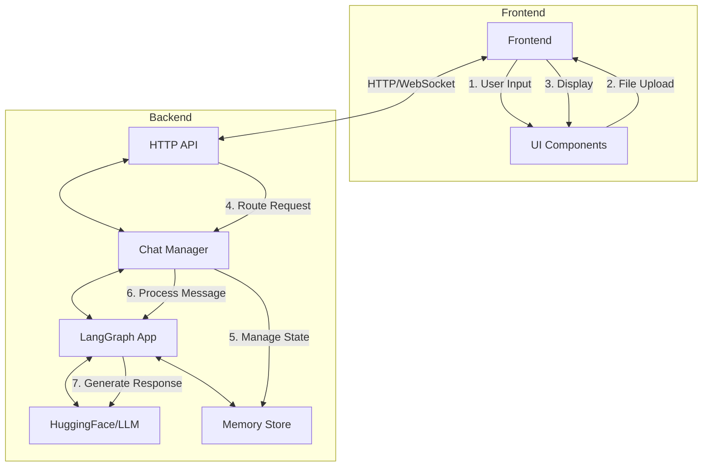

# System Architecture

## System Overview

This document describes the architecture of the File Analysis Chatbot, which provides an interactive interface for users to chat with AI models while analyzing and referencing uploaded files. The system is designed with a clear separation of concerns, making it maintainable, extensible, and scalable.

## 1. Frontend (Browser)

### Components:
- **UI Layer**: Built with HTML/CSS/JavaScript
  - Chat interface with message history
  - File upload interface with drag & drop
  - Model selection and configuration
  - Real-time feedback and error handling

### Key Features:
- **File Handling**:
  - Multiple file uploads with validation
  - File preview and management
  - Progress indicators
  - Keyboard shortcuts (Ctrl+U for upload)

- **State Management**:
  - Chat session persistence
  - File context maintenance
  - UI state (active tab, loading states)

### Design Choices:
- **Vanilla JavaScript**: Chosen for simplicity and to avoid framework overhead
- **Progressive Enhancement**: Core functionality works without JavaScript
- **Responsive Design**: Adapts to different screen sizes

## 2. HTTP API (Flask)

### Endpoints:
- `POST /create_chat`: Initialize a new chat session
- `POST /chat`: Send a message and get AI response
- `POST /clear_context`: Clear chat history
- `POST /delete_chat`: Remove a chat session
- `POST /change_model`: Switch AI models

### Responsibilities:
- Request validation and sanitization
- Authentication/Authorization (if implemented)
- Routing to appropriate handlers
- Error handling and response formatting

### Design Choices:
- **RESTful Design**: Clear separation of resources
- **Synchronous Processing**: Simple request/response model
- **Stateless**: Each request contains all necessary context

## 3. Chat Manager

### Core Components:
- **Chat State Management**:
  - Tracks active chat sessions
  - Maintains conversation history
  - Manages file context

- **Model Integration**:
  - Handles model initialization
  - Manages model parameters
  - Switches between different model types

### Key Features:
- **Session Management**:
  - Creates and destroys chat sessions
  - Maintains chat history
  - Handles context clearing

- **File Context**:
  - Stores and retrieves file contents
  - Maintains file metadata
  - Provides file context to the LLM

### Design Choices:
- **Singleton Pattern**: Single instance manages all chats
- **In-Memory Storage**: Simple implementation (can be replaced with DB)
- **Thread-Safe Operations**: Handles concurrent requests

## 4. LangGraph Integration

### Components:
- **State Management**:
  - Tracks conversation state
  - Manages memory
  - Handles context windows

- **Workflow Orchestration**:
  - Defines conversation flow
  - Manages tool execution
  - Handles error recovery

### Key Features:
- **Conversation Management**:
  - Maintains chat history
  - Handles context truncation
  - Manages token limits

- **Tool Integration**:
  - File analysis tools
  - Web search capabilities
  - Code execution (if enabled)

### Design Choices:
- **Graph-Based Workflow**: Clear flow definition
- **Modular Design**: Easy to extend with new tools
- **State Persistence**: Maintains context across turns

## 5. LLM Backend (HuggingFace/vLLM)

### Components:
- **Model Serving**:
  - Loads and serves LLM models
  - Handles batching and optimization
  - Manages GPU/CPU resources

- **Inference**:
  - Text generation
  - Token management
  - Sampling parameters

### Key Features:
- **Model Support**:
  - Multiple model architectures
  - Custom model loading
  - Quantization support

- **Performance**:
  - KV caching
  - Batch processing
  - Streaming support

### Design Choices:
- **vLLM Integration**: High-performance serving
- **Model Parallelism**: Handles large models
- **Optimized Inference**: Minimizes latency

## Data Flow

1. **User Input**:
   - User types a message or uploads files
   - Frontend validates and formats the input

2. **API Request**:
   - Request sent to backend with chat context
   - Includes message content and file metadata

3. **Request Processing**:
   - API validates and routes the request
   - Chat Manager retrieves or creates chat session
   - File context is attached to the message

4. **LLM Interaction**:
   - Message sent to LangGraph workflow
   - LLM generates response using context
   - Response formatted and returned

5. **Response Handling**:
   - API formats the response
   - Frontend updates the UI
   - Chat history updated

## Error Handling

### Frontend:
- Input validation
- Network error handling
- User-friendly error messages

### Backend:
- Input validation
- Model loading errors
- Rate limiting
- Resource management

## Security Considerations

### Implemented:
- Input validation
- File type restrictions
- Size limits
- CORS configuration

### Recommended:
- Authentication
- Rate limiting
- Request signing
- Audit logging

## Performance Considerations

### Frontend:
- Lazy loading
- Virtualized lists
- Optimized rendering

### Backend:
- Connection pooling
- Caching
- Asynchronous processing
- Resource management

## Scaling

### Horizontal Scaling:
- Stateless API servers
- Shared storage for chat history
- Load balancing

### Vertical Scaling:
- GPU acceleration
- Model optimization
- Batch processing

## Monitoring and Logging

### Metrics:
- Request latency
- Error rates
- Resource usage
- Model performance

### Logging:
- Request/response logging
- Error tracking
- Performance metrics

## Future Improvements

1. **Enhanced File Processing**:
   - Support for more file types
   - Better text extraction
   - File summarization

2. **Advanced Features**:
   - Multi-modal support
   - Code execution
   - Web search integration

3. **Scalability**:
   - Distributed training
   - Model sharding
   - Edge deployment

4. **User Experience**:
   - Real-time updates
   - Collaborative editing
   - Custom workflows
